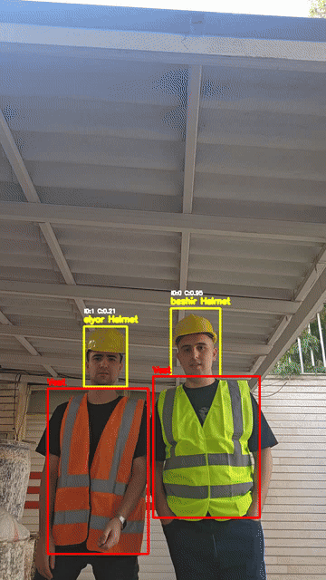
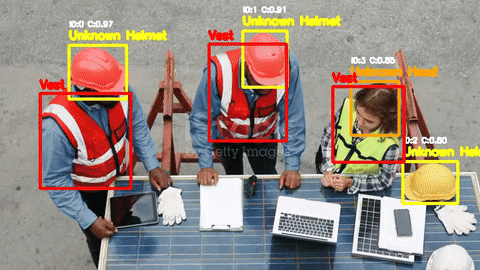

# PPE Detection, Tracking, and Face Recognition

Offline workplace-video pipeline. A Faster R-CNN model detects `helmet`, `head`, `body`, and `vest`. BoT-SORT keeps track ids. InsightFace matches faces to a local embedding database, and those names are attached to `helmet` and `head` tracks. The output is an annotated MP4.

The script does not open a live dashboard or send alarms. People who are not in `FaceRecognition/database/` are labeled `Unknown`. Gloves, boots, and goggles are not classes. The validation mAP below is not a certified safety metric.

## Result






The detector was fine-tuned in four stages. `training/result_stage_4.txt` records validation mAP@0.5:0.95:

| Stage | Best mAP@0.5:0.95 | Epochs run |
| --- | ---: | ---: |
| 1 | 0.2464 | 20 |
| 2 | 0.2927 | 12 |
| 3 | 0.2961 | 5 |
| 4 | 0.3957 | 10 of 20, early stop |

Stage 4 started from the stage-3 checkpoint (mAP 0.2961). Its best epoch was epoch 4, mAP@0.5:0.95 0.3957, with mAP@0.5 0.6214 and mAP@0.75 0.4804 on that epoch. Early stopping patience was 6. Training stopped after epoch 10. The epoch-10 mAP@0.5:0.95 was 0.3911. The weight file name uses the best value, 0.3957.

Stage 4 data in that log: 1,829 training images (4,862 boxes) and 457 validation images (1,176 boxes). The backbone kept stem, `layer1`, and `layer2` frozen and trained `layer3` and `layer4`, the RPN, and the ROI heads. Trainable parameters were 36,535,336 of 41,314,536 (88.43%). Optimizer was AdamW with cosine annealing. Learning rates were `2e-5` for `layer3` and `layer4`, and `5e-5` for the RPN and ROI heads. Batch size was 4. Image size in the training note and in `main_pt.py` is 640.

`training/metrics_per_class.png` shows precision, recall, and F1 by class. Recall is higher than precision for every class. Vest is the strongest of the four; helmet and body have the lower precision bars. `training/detection_results.png` shows the matching true-positive, false-positive, and false-negative counts. Helmet has the tallest false-positive bar.

`sample_output1.mp4` and `sample_output2.mp4` are demonstration inputs. The people in those two files were not enrolled, so the face labels in that output are `Unknown`.

## How a frame is labeled

| Piece | Role | File |
| --- | --- | --- |
| Faster R-CNN | PPE boxes | `models/faster_rcnn_best_stage4_mAP_0.3957.pth` |
| InsightFace `buffalo_l` | Face boxes and embeddings, every 20 frames | downloaded at runtime |
| BoT-SORT | Track ids | — |
| OSNet x0.25 | Optional ReID when `--reid` is set | `models/osnet_x0_25_msmt17.pt` |

`main_pt.py` maps model labels, after subtracting 1, to `helmet`, `head`, `body`, `vest`. Detections below confidence 0.35 are dropped. Boxes are computed at 640×640 and scaled back to the video frame.

A track gets its class from the current detection with IoU above 0.5. A face name is considered only for `helmet` and `head`, and only when the face box overlaps that track with IoU above 0.3. Identity uses cosine similarity against stored embeddings. The best score must be at least 0.35; otherwise the label is `Unknown`.

## Weights

The `models/` directory is gitignored. Place these two files there:

- [faster_rcnn_best_stage4_mAP_0.3957.pth](https://drive.google.com/file/d/1H6wJA4_VGpAUR0aSJtdsd_Ym1801Si2S/view?usp=drive_link)
- [osnet_x0_25_msmt17.pt](https://drive.google.com/file/d/1McAy-9stXVQVXKN1s3yW7gJo2yxf5fi6/view?usp=drive_link)

InsightFace `buffalo_l` is not in the repository. The app downloads it on startup, so that run needs network access.

## Run with Docker

The image is `pytorch/pytorch:2.11.0-cuda12.8-cudnn9-runtime`. GPU runs need an NVIDIA driver and the NVIDIA Container Toolkit.

From this folder:

```powershell
docker build -t ppe-face-recognition .
docker run --rm --gpus all `
  -v "${PWD}\input_video:/app/input_video" `
  -v "${PWD}\output_video:/app/output_video" `
  -v "${PWD}\FaceRecognition\database:/app/FaceRecognition/database" `
  ppe-face-recognition --video sample.mp4 --reid
```

```bash
docker build -t ppe-face-recognition .
docker run --rm --gpus all \
  -v "$(pwd)/input_video:/app/input_video" \
  -v "$(pwd)/output_video:/app/output_video" \
  -v "$(pwd)/FaceRecognition/database:/app/FaceRecognition/database" \
  ppe-face-recognition --video sample.mp4 --reid
```

`--reid` is optional. Put `sample.mp4` in `input_video/`. The container writes `output_video/sample_processed.mp4`.

## Register a face

Add one or more images under `FaceRecognition/register_images/<person>/`. `FaceRecognition/register.py` keeps an image only when InsightFace finds exactly one face, averages the embeddings, L2-normalizes the mean, and saves `FaceRecognition/database/<person>/embedding.npy`.

```bash
python FaceRecognition/register.py
```

Inside the image:

```powershell
docker run --rm --gpus all `
  --entrypoint python3 `
  -v "${PWD}\FaceRecognition:/app/FaceRecognition" `
  ppe-face-recognition /app/FaceRecognition/register.py
```

`register_images/` and `database/` are gitignored. Face embeddings are biometric data; keep them private and enroll only people who have agreed.

## Local run

`main_pt.py` needs Python 3.10 or newer, PyTorch, torchvision, the packages in `requirements.txt`, and FFmpeg/OpenCV libraries. CPU works; video processing is much slower than on GPU.

```powershell
python -m venv .venv
.venv\Scripts\Activate.ps1
python -m pip install --upgrade pip
python -m pip install torch torchvision
python -m pip install -r requirements.txt
python main_pt.py --video sample.mp4 --reid
```

## Training notebooks

`training/stage_1.ipynb` through `training/stage_4.ipynb` are the four fine-tuning stages. They were executed in Colab and save checkpoints on Google Drive. Running them again requires the dataset and those paths. The dataset itself is not in this repository.

## Limits

- Stage-4 validation mAP@0.5:0.95 is 0.3957. The per-class plots show many false positives, especially for helmet.
- Face recognition runs every 20 frames and reuses the last boxes in between.
- `body` and `vest` tracks are not given a person name.
- OSNet runs only with `--reid`.
- There is no web API. The product of a run is the MP4 in `output_video/`.
