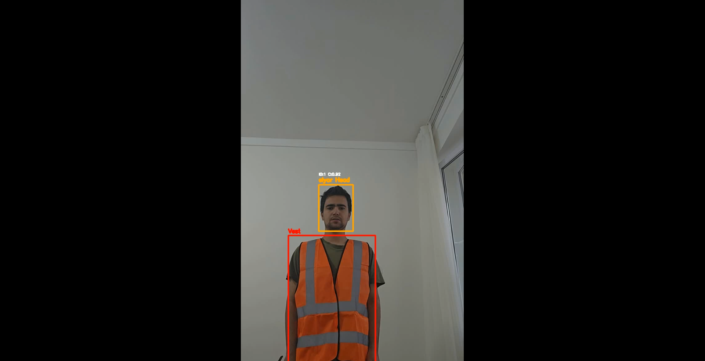
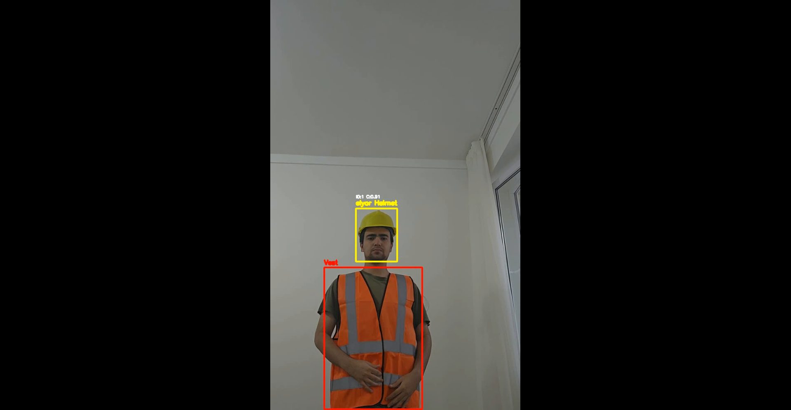
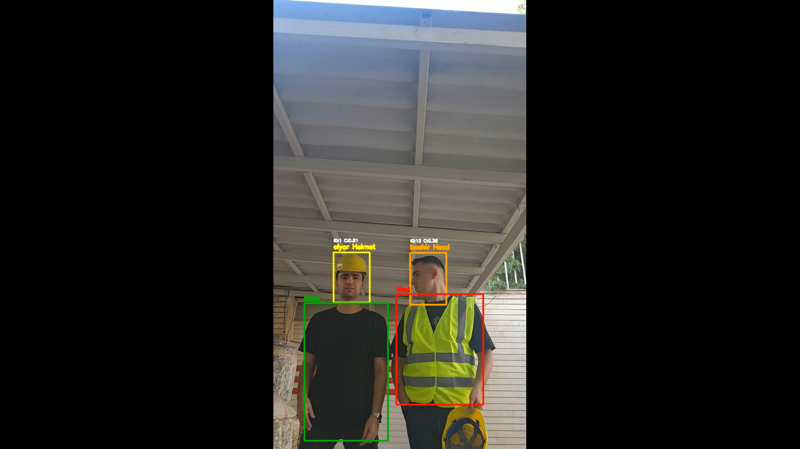
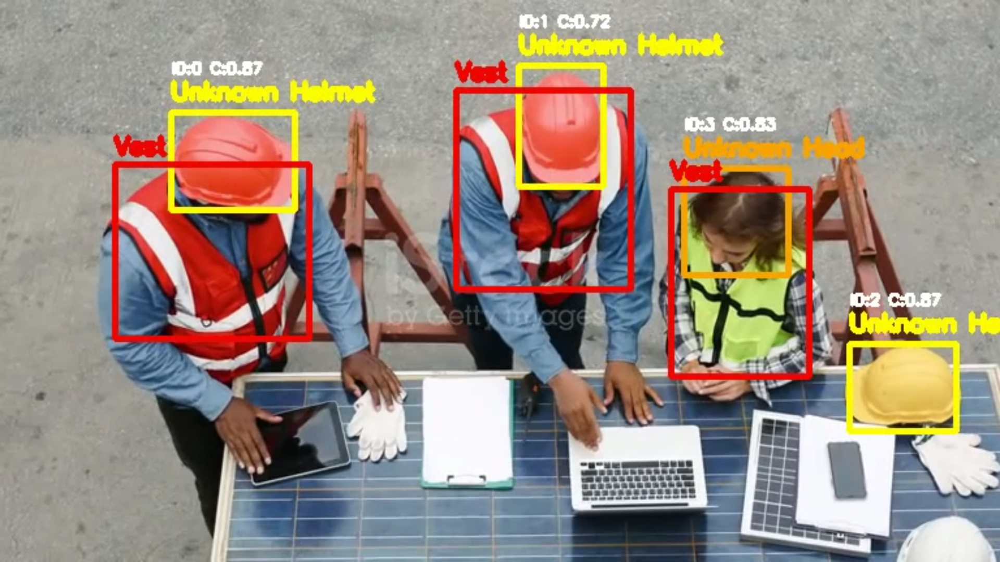

**PPE Detection, Multi-Object Tracking, and Face Recognition**

**Project Goal**

The goal of this project is to analyze workplace-safety videos: detect PPE-related objects (`helmet`, `head`, `body`, `vest`), track them across frames, optionally match registered faces to head/helmet detections, and write an annotated MP4. It is a video-processing pipeline for demonstration, research, and offline inspection of recorded footage.

**What This Project Does Not Do**

- It does not run a live camera dashboard, web UI, or public API.
- It does not send alarms, SMS, emails, or automatic compliance reports.
- It does not identify people who are not registered in the local face database (they are labelled `Unknown`).
- It does not detect other PPE types such as gloves, boots, or goggles.
- It does not claim production-grade or legally certified safety accuracy.

<video src="main_sample_output.mp4" controls preload="metadata">
  Your browser does not support the video tag. <a href="main_sample_output.mp4">Download the sample output video</a>.
</video>

**Sample Output Images**

Example frames from the pipeline (files in the project root):









An end-to-end computer vision pipeline for workplace-safety video analysis. The application detects PPE-related objects, tracks them across video frames, and optionally assigns registered identities to detected people.

**Sample Output Videos**
Example videos demonstrating the model's performance:

- `main_sample_output.mp4` - Main demonstration video
- `sample_output1.mp4` - Additional example

These videos show the model detecting PPE objects, tracking individuals across frames, and associating recognized faces with detected helmets and heads in real workplace scenarios.

**Note About `sample_output1.mp4` and `sample_output2.mp4`**
The videos `sample_output1.mp4` and `sample_output2.mp4` were downloaded from the internet and are used only as demonstration inputs for the pipeline.
The people appearing in these videos(`sample_output1.mp4` and `sample_output2.mp4`) were not registered in the face-recognition database. Therefore, the face-recognition module identifies them as `Unknown` because no matching registered face was available for these individuals.

---

**What This Project Does**

For every frame of an input video, the application performs the following workflow:

- **Face recognition, every 20 frames:** InsightFace detects faces and creates face embeddings. Each embedding is compared with the local face database. A person is labelled with a registered name when the similarity is above the configured threshold; otherwise the label is `Unknown`.

- **PPE detection:** A custom Faster R-CNN model detects four classes: `helmet`, `head`, `body`, and `vest`.

- **Tracking:** BoT-SORT associates detections between frames and assigns stable track IDs. OSNet ReID can optionally help the tracker re-identify people after occlusion or missed detections.

- **Association and visualization:** PPE boxes are associated with tracked objects. The application draws the class, confidence, track ID, and recognized name on the original-resolution frame.

- **Video output:** Processed frames are written as an MP4 file in `output_video/`.

```
Input video
    |
    +--> InsightFace / ONNX Runtime
    |    Face detection + face embeddings
    |    Every 20 frames
    |          |
    |          +--> Cosine similarity
    |               with FaceRecognition/database
    |
    +--> Faster R-CNN / PyTorch
         PPE detection
              |
              +--> BoT-SORT tracking
                       |
                       +--> Optional OSNet ReID
                                  |
                                  v
                         Annotated output video
```

---

**Main Components**

| Component | Technology | Responsibility | Model files |
|-----------|------------|----------------|-------------|
| PPE detector | PyTorch Faster R-CNN | Detects helmet, head, body, and vest | `models/faster_rcnn_best_stage4_mAP_0.3957.pth` |
| Face analysis | InsightFace (Buffalo_L) + ONNX Runtime | Detects faces and creates embeddings | Downloaded automatically at runtime |
| Tracker | BoT-SORT | Maintains object identities across frames | No separate model when ReID is disabled |
| Re-identification | OSNet | Helps match a person after missed detections or occlusion | `models/osnet_x0_25_msmt17.pt` |

The project uses both PyTorch and ONNX Runtime: PyTorch runs the Faster R-CNN PPE detector and optional OSNet ReID model, while ONNX Runtime runs the InsightFace face-analysis models.

---

**Face Recognition Model Details**

The Face Recognition component uses InsightFace with the Buffalo_L pretrained model for face detection and face embedding extraction.

- **Model:** InsightFace Buffalo_L
- **Format:** ONNX Runtime
- **Face detection:** `det_10g.onnx`
- **Face recognition embedding:** `w600k_r50.onnx`
- **Embedding size:** 512 dimensions
- **Output:** Face bounding boxes and 512-dimensional face embeddings
- **Training:** No project-specific fine-tuning is performed
- **Model download:** Automatic at runtime

The InsightFace models are not stored in the Git repository.

When the application starts, it checks for the required InsightFace models. The models are automatically downloaded at runtime when the container is started.

**Important:** In the current Docker setup, the InsightFace weights are downloaded when the container is run. Internet access is therefore required whenever the application needs to download the models.

---

**Training Metrics and Model Performance**

The PPE detector was trained progressively in four stages. Each stage starts from the best checkpoint produced by the previous stage and continues fine-tuning.

**Dataset Overview**
- Training images: **1,829**
- Validation images: **457**
- Training bounding boxes: **4,862**
- Validation bounding boxes: **1,176**

**Layer Freezing Strategy**
- Backbone: Only `layer3` and `layer4` unfrozen (layer1, layer2, and stem frozen)
- RPN: All layers fine-tuned
- ROI Heads: All layers fine-tuned
- Total parameters: **41,314,536**
- Trainable parameters: **36,535,336 (88.43%)**

**Stage-Wise Performance**

| Stage | mAP@0.5:0.95 | Improvement | Epochs |
|-------|--------------|-------------|--------|
| Stage 1 | 0.2464 | — | 20 |
| Stage 2 | 0.2927 | +0.0463 | 12 |
| Stage 3 | 0.2961 | +0.0034 | 5 |
| Stage 4 | *See evaluation results below* | *See evaluation results below* | 10 (early stopping) |

The final Stage 4 model is saved as:

```
models/faster_rcnn_best_stage4_mAP_0.3957.pth
```

**Final Evaluation Results (Stage 4)**

A comprehensive evaluation was performed on the validation set (457 images, 1,176 ground-truth boxes). The key results are:

**TorchMetrics mAP (standard COCO-style):**
- mAP@0.50:0.95 : **0.3910**
- mAP@0.50      : **0.6019**
- mAP@0.75      : **0.4638**
- mAR@100       : **0.6229**

**Per-Class AP:**
- `helmet` : 0.3450
- `head`   : 0.4680
- `body`   : 0.2848
- `vest`   : 0.4664

**Precision / Recall / F1 (Confidence ≥ 0.3, IoU ≥ 0.5):**

| Class | TP | FP | FN | Precision | Recall | F1 Score |
|-------|----|----|----|-----------|--------|----------|
| helmet | 393 | 559 | 58 | 0.4128 | 0.8714 | 0.5602 |
| head   | 179 | 233 | 35 | 0.4345 | 0.8364 | 0.5719 |
| body   | 170 | 336 | 52 | 0.3360 | 0.7658 | 0.4670 |
| vest   | 251 | 154 | 38 | 0.6198 | 0.8685 | 0.7233 |

**Overall Metrics:**
- Total TP : 993
- Total FP : 1282
- Total FN : 183
- Precision: **0.4365**
- Recall   : **0.8444**
- F1 Score : **0.5755**

and you can see the image ( metrics_per_class.png and  detection_results.png) in this folder: /training
overall result of stage 4 :(ppe\training\result_stage_4.txt)
---

**Code-Level Matching Logic**

The most important part of the implementation is the spatial association between two independent models:

- Faster R-CNN produces PPE detections.
- InsightFace produces face detections and identity names.
- BoT-SORT maintains track IDs.

The application connects these results using **Intersection over Union (IoU)** instead of assuming that detections are returned in the same order.

**1. Face Embeddings and Identity Matching**

The registration script processes every image in:

```
FaceRecognition/register_images/<person>/
```

An image is accepted only when exactly one face is detected.

For each valid image, InsightFace generates a face embedding. Multiple valid embeddings for the same person are averaged and then L2-normalized before being saved as:

```
embedding.npy
```

During inference, every detected face is normalized and compared with every stored database embedding using cosine similarity:

```
score = np.dot(query_embedding, database_embedding) / (
    np.linalg.norm(query_embedding) * np.linalg.norm(database_embedding)
)
```

The person with the highest similarity score is selected.

If the best score is below:

```
THRESHOLD_FACE = 0.35
```

the identity is assigned as:

```
Unknown
```

This makes identity matching independent of the order in which faces are detected.

**2. PPE Detection and Coordinate Conversion**

Each original frame is resized to:

```
PPE_SIZE x PPE_SIZE
```

The current configuration uses:


- `640 x 640` on GPU (recommended for higher accuracy)

The resized frame is passed to Faster R-CNN.

Predictions below:

```
CONF_THRESHOLD = 0.35
```

are discarded.

Because the detector works on the resized frame, the predicted coordinates are converted back to the original video dimensions using `scale_x` and `scale_y`.

The model's class IDs are mapped to the project labels as follows:

```
0 -> helmet
1 -> head
2 -> body
3 -> vest
```

**3. Associating Detections with Tracks**

The filtered PPE detections are converted into the format expected by BoT-SORT:

```
[x1, y1, x2, y2, confidence, class_id]
```

BoT-SORT uses these detections to maintain object identities across frames and assigns a track ID to each tracked object.

The helper function `get_current_class()` compares each tracker bounding box with the current PPE detection boxes using IoU.

The detection with the highest overlap provides the semantic class for that track, but the overlap must be greater than:

```
IoU > 0.5
```

This is useful because the tracker and detector provide different information:

- The detector provides the object class.
- The tracker provides the track ID and temporal identity.

IoU is used to spatially connect these two outputs.

**4. Matching a Face to head or helmet**

The function `get_face_name()` is called only for tracks whose class is:

```
helmet
head
```

The PPE track bounding box is compared with all cached face bounding boxes using IoU:

```
iou = calculate_iou(ppe_track_box, face_box)
```

The face with the highest IoU is selected only when:

```
IoU > 0.3
```

If no face satisfies this condition, the track remains:

```
Unknown
```

When the overlap is greater than:

```
IoU > 0.8
```

the search stops early because the match is already considered very strong.

In practical terms, the face box is usually located inside or near the upper region of the head or helmet detection. Their spatial overlap provides evidence that the detected PPE belongs to the recognized person.

The final annotation can look like:

```
elyar Helmet
ID:3 C:0.87
```

`body` and `vest` tracks are labelled only with their PPE class. The current implementation does not attach a face name to these classes.

**5. Temporal Behavior**

InsightFace is intentionally executed every 20 frames to reduce computational cost.

The latest:

- `face_boxes`
- `face_names`

are cached and reused between face-detection passes.

Meanwhile:

- Faster R-CNN continues running on every frame.
- BoT-SORT continues tracking on every frame.

This allows continuous object tracking while face recognition is performed periodically.

---

**Repository Structure**

```
.
├── Dockerfile
├── requirements.txt
├── main_pt.py
├── models/
│   ├── faster_rcnn_best_stage4_mAP_0.3957.pth  # Download separately
│   └── osnet_x0_25_msmt17.pt                   # Download separately
├── FaceRecognition/
│   ├── register.py
│   ├── register_images/<person>/
│   └── database/<person>/embedding.npy
├── training/
│   ├── stage_1.ipynb
│   ├── stage_2.ipynb
│   ├── stage_3.ipynb
│   └── stage_4.ipynb
├── input_video/
└── output_video/
```

**Note:** `register_images/` and `database/` contain private identity data and should not be committed to a public repository.

---

**Requirements**

**Docker with GPU**

The Docker setup requires:

- Docker Desktop or Docker Engine
- NVIDIA GPU
- Compatible NVIDIA driver
- NVIDIA Container Toolkit
- GPU support through `--gpus all`

The Docker image is based on:

```
pytorch/pytorch:2.11.0-cuda12.8-cudnn9-runtime
```

The host NVIDIA driver must support the CUDA runtime used by the image.

**InsightFace Model Download**

The InsightFace models are downloaded automatically at runtime.

In the current setup, the application downloads the required InsightFace weights when the container is started.

Therefore:

- Internet access is required for the model download.
- The download occurs during container execution rather than during the Docker image build.

**Local Python**

For local execution:

- Python 3.10 or newer
- PyTorch
- torchvision
- CUDA-compatible PyTorch installation for GPU inference, or CPU PyTorch for CPU execution
- Packages listed in `requirements.txt`
- FFmpeg
- OpenCV native libraries

GPU execution is strongly recommended for video processing. CPU execution is supported but significantly slower.

---

**Docker: How the Container Is Built**

Run Docker commands from the project root, the directory containing the Dockerfile.

```bash
docker build -t ppe-face-recognition .
```

The Docker build performs the following steps:

- Starts from a CUDA-enabled PyTorch runtime image.
- Installs FFmpeg, OpenCV system libraries, and other Linux runtime dependencies.
- Installs the Python packages from `requirements.txt`.
- Installs the required CUDA Python libraries for the PyTorch/ONNX Runtime environment.
- Refreshes the dynamic-linker cache.
- Creates `/app/input_video` and `/app/output_video`.
- Copies the project source code into `/app`.
- Sets the container entry point to:
  ```
  python3 /app/main_pt.py
  ```

**Important: InsightFace Models**

The Docker build does not need to include the InsightFace model weights.

When the container is started, the application downloads the required InsightFace models at runtime.

Because of this, an internet connection is required when the application performs the model download.

Arguments written after the image name are passed directly to `main_pt.py`.

---

**Docker: How the Container Runs**

The container uses the following important paths:

| Container path | Purpose | Recommended host mount |
|----------------|---------|------------------------|
| `/app/input_video` | Input videos | `./input_video` |
| `/app/output_video` | Generated videos | `./output_video` |
| `/app/FaceRecognition/database` | Registered face embeddings | `./FaceRecognition/database` |
| `/app/models` | PPE and ReID models copied into the image | Usually no mount needed |

**Run on Windows PowerShell with GPU**

First place a video such as `sample.mp4` inside `input_video/`.

Run with OSNet ReID enabled:

```powershell
docker run --rm --gpus all `
  -v "${PWD}\input_video:/app/input_video" `
  -v "${PWD}\output_video:/app/output_video" `
  -v "${PWD}\FaceRecognition\database:/app/FaceRecognition/database" `
  ppe-face-recognition --video sample.mp4 --reid
```

The `--reid` flag is optional.

To run without OSNet ReID:

```powershell
docker run --rm --gpus all `
  -v "${PWD}\input_video:/app/input_video" `
  -v "${PWD}\output_video:/app/output_video" `
  -v "${PWD}\FaceRecognition\database:/app/FaceRecognition/database" `
  ppe-face-recognition --video sample.mp4
```

The processed video will be created on the host at:

```
output_video\sample_processed.mp4
```

`--rm` removes the stopped container. The generated video remains on the host because `output_video` is mounted as a volume.

**Run on Linux or macOS**

```bash
docker run --rm --gpus all \
  -v "$(pwd)/input_video:/app/input_video" \
  -v "$(pwd)/output_video:/app/output_video" \
  -v "$(pwd)/FaceRecognition/database:/app/FaceRecognition/database" \
  ppe-face-recognition --video sample.mp4 --reid
```

---

**Sample Output Videos**

The `output_video/` folder contains example outputs demonstrating the system's capabilities:

- `main_sample_output.mp4`: Primary demonstration showing PPE detection, face recognition, and multi-object tracking.
- `sample_output1.mp4` and `sample_output2.mp4`: Additional example demonstrating the pipeline under different visual conditions and object occlusions.

The sample videos demonstrate:

- Bounding boxes for `helmet`, `head`, `body`, and `vest`
- Stable track IDs across frames
- Face recognition labels such as registered names or `Unknown`
- Detection confidence scores
- Spatial association between faces and head/helmet
- Optional OSNet-based re-identification

These videos provide examples of the expected inference output.

---

**Face Registration**

Face recognition uses a local face database. It does not identify people through a remote face-recognition service.

**1. Add Registration Images**

Add one or more images for each person:

```
FaceRecognition/register_images/
├── person_a/
│   ├── image_01.jpg
│   └── image_02.jpg
└── person_b/
    └── image_01.jpg
```

**2. Run the Registration Script**

Run locally:

```bash
python FaceRecognition/register.py
```

The script:

- Detects faces in each image.
- Accepts an image only when exactly one face is detected.
- Generates a face embedding.
- Averages valid embeddings for each person.
- L2-normalizes the resulting embedding.
- Saves it as:
  ```
  FaceRecognition/database/<person>/embedding.npy
  ```

**3. Use the Database During Inference**

When `main_pt.py` starts, it loads the available `embedding.npy` files from:

```
/app/FaceRecognition/database
```

Because the database directory is mounted as a Docker volume, newly registered identities can be used without rebuilding the Docker image.

**Generate Embeddings Inside Docker**

Windows PowerShell:
```powershell
docker run --rm --gpus all `
  --entrypoint python3 `
  -v "${PWD}\FaceRecognition:/app/FaceRecognition" `
  ppe-face-recognition /app/FaceRecognition/register.py
```

Linux or macOS:
```bash
docker run --rm --gpus all \
  --entrypoint python3 \
  -v "$(pwd)/FaceRecognition:/app/FaceRecognition" \
  ppe-face-recognition /app/FaceRecognition/register.py
```

Use clear images containing exactly one face and obtain appropriate consent from every identifiable person.

---

**Local Execution Without Docker**

Run the following commands from the project root.

The local setup requires PyTorch and torchvision in addition to the packages listed in `requirements.txt`.

```bash
python -m venv .venv
.venv\Scripts\Activate.ps1

python -m pip install --upgrade pip

# Install the PyTorch/torchvision build that matches your CPU or CUDA setup.
python -m pip install torch torchvision

python -m pip install -r requirements.txt
```

Then run:

```bash
python main_pt.py --video sample.mp4 --reid
```

Place `sample.mp4` inside:

```
input_video/
```

The application writes the processed video to:

```
output_video/sample_processed.mp4
```

An absolute video path is also supported:

```bash
python main_pt.py --video C:\videos\sample.mp4
```

---

**Training**

The PPE detector was trained progressively in four notebooks. Each stage starts from the best checkpoint produced by the previous stage and continues fine-tuning.

- `stage_1.ipynb` - Initial training
- `stage_2.ipynb` - Fine-tuning from Stage 1
- `stage_3.ipynb` - Additional fine-tuning and validation
- `stage_4.ipynb` - Final fine-tuning and checkpoint export

Stage 4 uses:
- `640 x 640` training images
- Batch size 4
- Up to 20 epochs
- Early stopping patience of 6
- Data augmentation
- Gradient clipping
- Separate learning rates for the backbone, RPN, and ROI head

**Important Notes on Training Code**

The training notebooks are provided as demonstrations of the coding approach and training methodology. They are not guaranteed to run directly without modification.

You may need to update:

- Dataset paths
- Model checkpoint paths
- Output directories
- Training-specific dependencies
- GPU-dependent settings

To use the notebooks for your own training:

- Prepare an annotated PPE dataset in the expected format.
- Update the dataset and output paths.
- Verify image dimensions, batch size, and hyperparameters for your GPU.
- Run the training stages sequentially.

**Final Stage 4 Results**

The best checkpoint is:

```
models/faster_rcnn_best_stage4_mAP_0.3957.pth
```

---

**Dataset**

The PPE dataset was obtained from a publicly available internet source. The original source URL is no longer available in the project records, so no unverified link is provided.

The dataset is used for training and validation and is available separately upon request. The dataset file is not included in this repository due to its size and distribution considerations. If needed, the dataset file can be provided separately upon request.

---

**Privacy Notes**

- Keep `register_images/`, `database/`, and private videos out of the public repository unless you have appropriate consent.
- Face embeddings are biometric data and should be treated as sensitive information, even if the original images are deleted.
- Do not publish identifiable registration images without appropriate permission.
- The project currently does not include a license. Add an appropriate open-source license if you plan to accept contributions or distribute the project under specific terms.

---

**Limitations**

- Detection accuracy depends on lighting, camera angle, occlusion, image quality, and training-data coverage.
- Face recognition may return `Unknown` for poor-quality, partially visible, or unregistered faces.
- Face detection runs every 20 frames, so very fast movement may reduce recognition stability.
- CPU inference is significantly slower than GPU inference.
- The current pipeline produces an annotated video and does not expose a web API or dashboard.
- OSNet ReID is optional and increases computational cost when enabled.
- The reported validation mAP should not be assumed to represent real-world production accuracy.

---

**Model Weights**

Due to their large file size, the pretrained model weights are not included in this repository.

The required model weights can be downloaded from the following Google Drive links:

- **Faster R-CNN PPE detector:** `faster_rcnn_best_stage4_mAP_0.3957.pth` – [Download from Google Drive](https://drive.google.com/file/d/1H6wJA4_VGpAUR0aSJtdsd_Ym1801Si2S/view?usp=drive_link)
- **OSNet ReID model:** `osnet_x0_25_msmt17.pt` – [Download from Google Drive](https://drive.google.com/file/d/1McAy-9stXVQVXKN1s3yW7gJo2yxf5fi6/view?usp=drive_link)

After downloading, place the files in the `models/` directory:

```
models/
├── faster_rcnn_best_stage4_mAP_0.3957.pth
└── osnet_x0_25_msmt17.pt
```

The InsightFace Buffalo_L model weights are not included in the repository. They are downloaded automatically at runtime when the application starts and the required models are not available in the InsightFace cache.